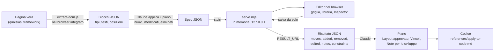

# wireframe

Una skill per [Claude Code](https://claude.com/claude-code) che, mentre pianifichi una modifica al frontend, apre un **mockup dell'intera pagina** con i testi veri e un tipo per ogni elemento: bottone, campo data, lookup, tabella. Lo riorganizzi trascinando, aggiungi componenti da una libreria, imposti i vincoli dei campi e lasci note per chi svilupperà. Il risultato torna nel piano prima che venga scritto il codice.

Parte solo quando la chiami con `/wireframe`.

## In breve

1. **Legge la pagina vera.** Parte dall'HTML reso, senza conoscere il framework. Riconosce sezioni, titoli, link, bottoni, gruppi di bottoni, tab, tabelle e campi, ognuno con il suo tipo. Un campo e la sua etichetta sono un'unità sola, e un campo con il bottone di ricerca diventa un lookup. Dei campi legge obbligatorietà e vincoli dagli attributi HTML, mai i valori.
2. **Applica il piano.** Gli elementi nuovi sono blu, quelli modificati gialli, quelli eliminati spariscono. È la versione di partenza: quella che verrebbe realizzata se non toccassi nulla.
3. **Ti lascia lavorare.** Sposti e ridimensioni i blocchi su una griglia con aggancio, aggiungi componenti, elimini, cambi testi e tipi, scomponi un gruppo nei suoi elementi, imposti i vincoli e scrivi note.
4. **Riporta il risultato nel piano.** Quando torni in chat e rispondi «Ho finito», Claude aggiunge al piano lo schema del layout, gli spostamenti, gli elementi aggiunti, eliminati e modificati, la tabella dei vincoli e le note per lo sviluppo, parola per parola.

Funziona con qualsiasi framework. Il server lavora in memoria e non scrive su disco, quindi non tocca i file del progetto: è pensata anche per la modalità piano.

## Come funziona

La skill è fatta di tre pezzi che si passano dati in JSON: uno script che gira **dentro la pagina**, un server che gira **sul tuo PC** e un editor che gira **nel browser**. Claude sta in mezzo: legge la pagina, applica il piano, apre l'editor e alla fine aggiorna il piano.



| Pezzo | Dove gira | Cosa fa |
|---|---|---|
| `scripts/extract-dom.js` | nella pagina, tramite il browser integrato dell'app Claude | Legge l'HTML reso e restituisce i blocchi: tipo, etichetta, selettore, posizione su una griglia a 12 o 24 colonne, vincoli dei campi, disegno interno (`parts`) |
| Claude | in chat | Trasforma i blocchi nella pagina come la prevede il piano e li passa al server |
| `scripts/serve.mjs` | sul tuo PC, solo su `127.0.0.1` | Tiene la spec e lo stato in memoria, serve l'editor, restituisce il risultato e si spegne |
| `assets/editor.*` | nel browser | La griglia trascinabile ([GridStack](https://gridstackjs.com)), la libreria, l'Inspector, le note, i temi; salva a ogni modifica |
| `assets/catalog.js` | nel browser | Il catalogo dei tipi: nome, categoria, disegno, misure e testo predefiniti |
| `assets/sketch.js` | nel browser | Il disegno di ogni tipo nei quattro temi |
| `assets/constraints.js` | nel browser | I vincoli dei campi: sezione dell'Inspector, sintesi, confronto |

Il formato completo dei dati è in [`references/spec.md`](references/spec.md). Gli esempi qui sotto sono presi dalla maschera di prova [`tests/fixtures/maschera.html`](tests/fixtures/maschera.html).

### 1. Dalla pagina ai blocchi

Ogni elemento della pagina diventa un blocco. Il campo «Fornitore» della maschera è un `<label for>`, un `<input required>` e un bottone con la lente:

```html
<label for="fornitore">Fornitore</label>
<div class="lookup">
  <input id="fornitore" required placeholder="Codice fornitore">
  <button type="button" title="Cerca fornitore">🔍</button>
</div>
```

L'estrazione li unisce in un solo blocco di tipo `lookup`, obbligatorio:

```json
{
  "id": "input-6",
  "tag": "input",
  "type": "lookup",
  "label": "Fornitore",
  "selector": "#fornitore",
  "x": 0, "y": 1, "w": 4, "h": 2,
  "status": "existing",
  "required": true
}
```

- `x` e `w` sono colonne della griglia, `y` e `h` righe. Dentro una sezione partono dal bordo della sezione.
- `selector` serve a Claude per ritrovare l'elemento nei sorgenti.
- Il valore del campo non viene mai letto. Si leggono solo etichetta, tipo e attributi: `required`, `readonly`, `minlength`, `maxlength`, `min`, `max`, `step`, `pattern`. Un `<input maxlength="16">` diventerebbe `"constraints": { "maxLength": 16 }`.

Un blocco che contiene più cose, come la barra dei bottoni, si porta dietro il suo disegno in `parts`: ogni parte è `[tipo, x, y, w, h, testo]`, con le misure in percentuale del blocco.

```json
{
  "id": "div-16",
  "tag": "div",
  "type": "button-group",
  "label": "Azioni",
  "x": 0, "y": 20, "w": 12, "h": 2,
  "parts": [
    ["button", 0, 0, 9, 100, "Cerca"],
    ["button", 11, 0, 10, 100, "Pulisci"],
    ["button", 23, 0, 16, 100, "Nuovo ordine"],
    ["button", 41, 0, 10, 100, "Elimina"]
  ]
}
```

### 2. Il livello di dettaglio

Quanto si può spostare lo decide la granularità, scelta all'avvio. Claude la passa allo script così:

```js
window.WF_OPTIONS = { granularity: 'elementi' };
// ...poi il testo di extract-dom.js
```

| Livello | Cosa diventa un blocco | Sulla maschera di prova |
|---|---|---|
| `sezioni` | solo i blocchi principali, il resto è disegno | 8 blocchi: header, breadcrumb, titolo, tabs, form, gruppo di bottoni, tabella, paginazione |
| `blocchi` (predefinito) | sezioni e unità di contenuto | 18 blocchi: i campi del form si spostano uno per uno |
| `elementi` | ogni bottone, link e campo, su 24 colonne | 33 blocchi: anche «Cerca», «Pulisci», «Nuovo ordine» ed «Elimina» si spostano da soli |

Con `blocchi` puoi comunque liberare i bottoni di un gruppo dall'editor, con **Scomponi**: le parti diventano blocchi figli con id `div-16.p0`, `div-16.p1` e così via.

### 3. Il piano entra nel mockup

Prima di aprire l'editor, Claude applica il piano ai blocchi. Se il piano dice «aggiungere un filtro obbligatorio per data di consegna», nel mockup compare già un blocco nuovo, blu:

```json
{
  "id": "consegna",
  "tag": "input",
  "type": "input-date",
  "label": "Data di consegna",
  "x": 4, "y": 7, "w": 4, "h": 2,
  "status": "new",
  "required": true,
  "constraints": { "min": "2026-01-01" }
}
```

I blocchi che il piano modifica hanno `status: "changed"` e sono gialli; quelli che elimina spariscono. Le note no: le scrivi solo tu.

### 4. Nell'editor

Ecco cosa puoi fare sulla maschera in un minuto:

- trascini **Elimina** fuori dal gruppo di bottoni e lo metti sotto la tabella;
- trascini dalla libreria un **Checkbox** dentro il form e lo chiami «Solo con allegati»;
- sul campo **Fornitore** imposti lunghezza massima 16 e formato *Partita IVA*, e scrivi la nota «Precompilato con il fornitore dell'utente, modificabile»;
- elimini il campo **Email referente**.

Ogni modifica si salva nel server. Se ricarichi la pagina riparti da dove eri.

### 5. Il risultato

Quando rispondi «Ho finito», Claude legge `RESULT_URL`. Per le modifiche qui sopra il risultato contiene, in sintesi:

```json
{
  "changed": true,
  "moves": [
    { "id": "div-16.p3", "label": "Elimina", "touched": true, "kinds": ["parent", "position"],
      "from": { "parent": "div-16", "x": 3, "y": 0, "w": 1, "h": 2 },
      "to":   { "parent": null,     "x": 0, "y": 28, "w": 2, "h": 2 } }
  ],
  "added": [
    { "id": "nuovo-1", "type": "checkbox", "label": "Solo con allegati", "parent": "form-5", "x": 8, "y": 8, "w": 3, "h": 1 }
  ],
  "removed": [
    { "id": "input-11", "type": "input-email", "label": "Email referente", "selector": "#email", "parent": "form-5" }
  ],
  "edited": [
    { "id": "input-6", "label": "Fornitore", "selector": "#fornitore",
      "fields": { "constraints": { "from": null, "to": { "maxLength": 16, "format": "partita-iva" } } } }
  ],
  "notes": [
    { "n": 1, "id": "input-6", "type": "lookup", "label": "Fornitore", "selector": "#fornitore",
      "note": "Precompilato con il fornitore dell'utente, modificabile" }
  ],
  "constraints": [
    { "id": "input-6", "type": "lookup", "label": "Fornitore", "required": true,
      "constraints": { "maxLength": 16, "format": "partita-iva" } }
  ],
  "outline": "form \"Filtri di ricerca\" [12/12]\n  dentro form \"Filtri di ricerca\":\n    lookup* \"Fornitore\" {obbl., max 16, formato P.IVA} [nota 1] [4/12] | input-date \"Data dal\" [4/12] | ..."
}
```

- `touched: true` vuol dire che l'hai spostato tu; `false`, che è stato spinto da un altro blocco.
- `constraints` descrive lo stato finale di tutti i campi vincolati, non solo di quelli cambiati.
- `outline` è lo schema del layout: ogni riga è una fila, `|` separa le colonne, `[4/12]` è la larghezza sulle colonne del contenitore, `*` vuol dire obbligatorio.

### 6. Dal risultato al piano

Claude riporta il risultato nel piano in questa forma:

````markdown
## Layout approvato

```text
form "Filtri di ricerca" [12/12]
  dentro form "Filtri di ricerca":
    lookup* "Fornitore" {obbl., max 16, formato P.IVA} [nota 1] [4/12] | input-date "Data dal" [4/12] | ...
```

Spostamenti:
- Elimina fuori dal gruppo di bottoni, sotto la tabella

Elementi aggiunti:
- Checkbox «Solo con allegati» nel form Filtri di ricerca

Elementi eliminati:
- Campo email «Email referente» (`#email`)

Vincoli applicativi:

| Elemento | Selettore | Vincoli |
|---|---|---|
| Fornitore (lookup) | `#fornitore` | obbligatorio, max 16 caratteri, formato partita IVA |

Note per lo sviluppo:
1. Fornitore (`#fornitore`): «Precompilato con il fornitore dell'utente, modificabile»
````

Note e vincoli sono requisiti: quando scrive il codice, Claude li porta nelle validazioni lato client e lato server con i meccanismi che il progetto ha già. Le regole sono in [`references/apply-to-code.md`](references/apply-to-code.md).

## Installazione

È una cartella con `SKILL.md` alla radice: basta metterla in `~/.claude/skills/wireframe`.

**Con git**

```bash
git clone https://github.com/Giovanni1926/wireframe ~/.claude/skills/wireframe
```

Per aggiornarla:

```bash
git -C ~/.claude/skills/wireframe pull
```

**Con npx**, usando [`skills`](https://github.com/vercel-labs/skills), un installer di terzi che non fa parte di Claude Code:

```bash
npx skills add Giovanni1926/wireframe -g -a claude-code --copy
```

`-g` la installa per tutti i progetti e `--copy` copia i file invece di collegarli. Per aggiornarla: `npx skills update wireframe`.

**Solo per un progetto:** copia la cartella in `.claude/skills/wireframe/` del progetto e committala. Chi clona il progetto ha la skill.

## Uso

```text
/wireframe [URL, pagina o file] [pannello] [sezioni|elementi]
```

- Senza argomenti usa la pagina di cui stai parlando nella conversazione, oppure te la chiede.
- Con un URL, un file HTML o il nome di una pagina parte da quella.
- Con la parola `pannello` il mockup si apre nel browser integrato dell'app Claude invece che in una finestra del browser.
- Con `sezioni` o `elementi` scegli il livello di dettaglio; senza, vale `blocchi`.

Se la pagina è in esecuzione la legge da lì. Se l'app è spenta può partire dai sorgenti, con una struttura approssimata. Se la pagina non esiste ancora, la compone dal piano.

Esempi:

```text
/wireframe http://localhost:8080/areas/ordini.do
/wireframe http://localhost:8080/areas/ordini.do elementi
/wireframe tests/fixtures/maschera.html pannello
/wireframe la nuova pagina di riepilogo ordini
```

## Provarla senza Claude

L'editor si apre anche a mano, con i blocchi già estratti dalla maschera di prova. Dalla cartella della skill:

```bash
node scripts/serve.mjs --open < tests/fixtures/maschera.spec.json
```

Il comando stampa due indirizzi:

```text
WIREFRAME_URL=http://127.0.0.1:64712/
RESULT_URL=http://127.0.0.1:64712/result?t=…&close=1
```

Lavora nell'editor, poi apri `RESULT_URL` nel browser o con `curl`: vedi il risultato e il server si spegne.

## L'editor

- **Libreria.** A sinistra, con i componenti divisi per categoria (Layout, Testo, Azioni, Campi, Dati, Media), un'anteprima grande per ognuno e un filtro. Trascini una tessera sulla pagina o dentro una sezione, oppure la clicchi: va nella sezione selezionata o sotto il blocco selezionato. Il pannello si sposta dall'intestazione e si comprime. Ctrl+K apre l'aggiunta veloce per nome.
- **Inspector.** Clic su un blocco per vederne tipo, testo, vincoli, elementi ripetuti e nota. Doppio clic o F2 cambiano il testo sul posto. In fondo ci sono Duplica, Scomponi ed Elimina.
- **Vincoli.** Per i campi: obbligatorio, sola lettura, disabilitato, lunghezza minima e massima, valore minimo e massimo, decimali, formato (codice fiscale, partita IVA, IBAN, email, CAP, telefono, solo cifre o regex), valore predefinito e messaggio di errore. Un campo obbligatorio ha l'asterisco, uno in sola lettura il lucchetto, e il formato compare come segnaposto.
- **Note.** Ogni blocco può avere una nota per lo sviluppo: comportamento, regole, dati. Compare come post-it numerato e arriva nel piano come requisito.
- **Scomponi.** Trasforma ciò che è disegnato dentro un blocco, per esempio i bottoni di un gruppo o le voci delle tab, in elementi da spostare e annotare uno per uno.
- **Testi per esteso.** Le etichette si leggono intere: il testo va a capo tra le parole e, se un blocco è troppo stretto, l'editor lo allarga da solo.
- **Temi.** Wireframe pulito (predefinito), Pulito scuro, Schizzo e Blueprint. Il tema scelto resta anche se ricarichi la pagina. I pulsanti Tipi e Note mostrano o nascondono il tipo di ogni blocco e i post-it.
- **Zoom.** Da 50% a 200%, con −, + e Adatta.
- **Esporta PNG.** Salva un'immagine del mockup, da allegare a un ticket o a una mail.

Ogni modifica si salva da sola. Gli elementi nuovi sono blu, quelli modificati gialli e quelli che hai spostato tu viola.

| Tasti | Azione |
|---|---|
| Ctrl+K | Aggiunta veloce |
| Doppio clic, F2 | Cambia il testo |
| Canc | Elimina il blocco selezionato |
| Ctrl+D | Duplica |
| Ctrl+Z | Annulla |
| Ctrl+Shift+Z, Ctrl+Y | Ripeti |
| Ctrl + / Ctrl − / Ctrl 0 | Zoom avanti, indietro, 100% |
| Ctrl+rotellina | Zoom |
| Esc | Deseleziona |

Su Mac, Cmd al posto di Ctrl.

## Aggiungere un tipo

Il catalogo è l'unico posto dove un tipo è definito: libreria, Inspector e disegno lo leggono da lì. Per aggiungere, per esempio, un campo colore:

1. In `assets/catalog.js` aggiungi una riga a `ROWS`, nel formato `[tipo, categoria, nome, disegno, w, h, testo predefinito, opzioni]`:

   ```js
   ['input-color', 'fields', 'Campo colore', 'field', 3, 1, 'Colore', { field: true }],
   ```

   Se vuoi un testo d'esempio nella tessera della libreria, aggiungi anche una voce in `SAMPLES`.
2. Il disegno `field` esiste già. Per un disegno nuovo aggiungi un widget con lo stesso nome in `widgets` di `assets/sketch.js`: riceve `(scene, rect, text, options)` e disegna con `scene.pen` e `scene.label`.
3. Perché l'estrazione lo riconosca, mappalo in `scripts/extract-dom.js`: per un input basta cambiare `color` in `INPUT_TYPES` da `'input-text'` a `'input-color'`.
4. Se ha vincoli suoi, dichiarali in `applicable(type)` di `assets/constraints.js`.

## Requisiti

- **Node.js.** Serve per il server locale. L'ho provata con la versione 22.
- **App desktop di Claude**, per leggere una pagina in esecuzione: l'estrazione usa il suo browser integrato. Altrove la skill può partire dai sorgenti.
- **Un browser** per l'editor, che si apre in quello predefinito del sistema.

## Cosa passa e dove

- Il server ascolta solo su `127.0.0.1`, controlla host e origine delle richieste e si spegne da solo dopo 60 minuti di inattività.
- L'estrazione non legge i valori dei campi dei moduli e taglia i testi molto lunghi, ma i titoli, le etichette, i link e i bottoni visibili finiscono nella conversazione con Claude: non usarla su pagine con dati che non vuoi condividere.

## Com'è fatta

```text
wireframe/
├── SKILL.md               le istruzioni per Claude
├── scripts/
│   ├── extract-dom.js     legge la pagina e restituisce i blocchi
│   └── serve.mjs          il server locale dell'editor
├── assets/
│   ├── editor.html        la pagina dell'editor
│   ├── editor.js          griglia, libreria, Inspector, note, salvataggio e risultato
│   ├── catalog.js         il catalogo dei tipi
│   ├── constraints.js     i vincoli dei campi
│   ├── sketch.js          il disegno dei blocchi e i temi
│   ├── themes.css         i colori dei temi
│   └── vendor/            GridStack 14.0.0 e html-to-image (MIT), con le licenze
├── references/
│   ├── spec.md            il formato dei dati e il catalogo dei tipi
│   └── apply-to-code.md   come portare il risultato nel codice
└── tests/fixtures/
    ├── sample.html        una pagina di prova
    ├── maschera.html      una maschera di ricerca gestionale
    └── maschera.spec.json i blocchi già estratti da maschera.html, per aprire l'editor a mano
```

`maschera.html` contiene lookup, date, numero, select, email, checkbox, radio, toggle, textarea, gruppo di bottoni, tab, tabella e paginazione: serve a provare l'estrazione dei tipi.

## Stato

Versione 2.1: tipi, libreria, Inspector, vincoli, note, Scomponi, temi, zoom ed export PNG. L'estrazione e l'editor sono provati a mano sulle pagine di prova. L'uso completo con `/wireframe` in una sessione in modalità piano non è ancora stato verificato.

## Licenza

[MIT](LICENSE). L'editor include GridStack 14.0.0 e html-to-image, entrambi MIT, con le loro licenze in [`assets/vendor/`](assets/vendor/).
